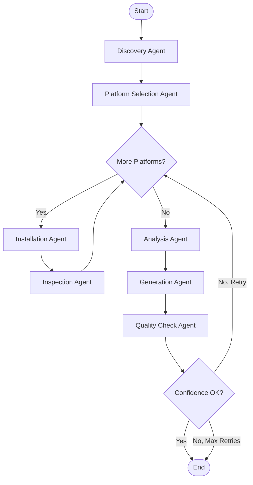

# Saitest Design Document

## Overview

Saitest is an agent-based verification tool that uses LangGraph to orchestrate AI agents that install software in Docker containers, observe system changes, and generate validated saidata. The tool integrates into the sai-suite monorepo, sharing code with saigen and sai.

## Architecture

### High-Level Architecture

```
┌─────────────────────────────────────────────────────────────┐
│                     SAITEST CLI                              │
├─────────────────────────────────────────────────────────────┤
│                                                              │
│  ┌──────────────┐      ┌──────────────┐                    │
│  │   Commands   │──────│ Orchestrator │                    │
│  │  verify/test │      │  (LangGraph) │                    │
│  └──────────────┘      └───────┬───────┘                    │
│                                 │                            │
│         ┌───────────────────────┼───────────────────┐       │
│         │                       │                   │       │
│    ┌────▼─────┐         ┌──────▼──────┐     ┌─────▼────┐  │
│    │ Container│         │   Agents    │     │  Tools   │  │
│    │ Manager  │         │  (7 types)  │     │ (System) │  │
│    └────┬─────┘         └──────┬──────┘     └─────┬────┘  │
│         │                      │                   │       │
└─────────┼──────────────────────┼───────────────────┼───────┘
          │                      │                   │
     ┌────▼─────┐         ┌──────▼──────┐     ┌─────▼────┐
     │  Docker  │         │     LLM     │     │ Monitors │
     │ Containers│         │  (GPT-4o)   │     │(FS/Proc) │
     └──────────┘         └─────────────┘     └──────────┘
```

### LangGraph Workflow



## Components and Interfaces

### 1. Core State Management

**VerificationState (TypedDict)**
- Purpose: Central state object passed between all agents
- Fields:
  - Input: software, input_saidata, target_platforms
  - Discovery: discovery_complete, installation_methods, expected_services/files/ports
  - Platform: selected_platforms, current_platform
  - Results: platform_results (List[PlatformResult])
  - Analysis: aggregated_observations, patterns, variations
  - Generation: generated_saidata, confidence_scores
  - Quality: validation_errors, completeness_score, accuracy_score, overall_confidence
  - Control: retry_count, max_retries, needs_human_review
  - Metadata: start_time, messages

**Observation (Pydantic Model)**
- Purpose: Single data point from system monitoring
- Fields: type, platform, provider, timestamp, data (Dict), confidence

**PlatformResult (Pydantic Model)**
- Purpose: Results from testing one platform with one provider
- Fields: platform, provider, success, observations (List[Observation]), errors, duration

### 2. Container Management

**ContainerManager**
- Purpose: Manage Docker container lifecycle
- Methods:
  - `get_image_for_platform(platform: str) -> str`: Map platform to Docker image
  - `spawn_container(platform: str) -> ContainerWrapper`: Context manager for container lifecycle
- Responsibilities:
  - Pull images if not cached
  - Create privileged containers
  - Track active containers
  - Ensure cleanup on exit

**ContainerWrapper**
- Purpose: Wrapper for container operations
- Methods:
  - `exec(command: str) -> Dict`: Execute command and return result
  - `read_file(path: str) -> str`: Read file from container
  - `list_files(path: str) -> List[str]`: List files in directory
- Returns: Dict with exit_code, output, success

### 3. Filesystem Monitoring

**FilesystemMonitor**
- Purpose: Track filesystem changes during installation
- Methods:
  - `capture_baseline()`: Snapshot filesystem before installation
  - `capture_changes() -> List[FileChange]`: Detect new/modified files
  - `get_service_files() -> List[str]`: Find systemd service files
  - `get_binaries() -> List[str]`: Find executable binaries
- Implementation: Uses `find` command to compare before/after states

**FileChange (Dataclass)**
- Fields: path, change_type, timestamp, size, permissions

### 4. LangGraph Tools

**Unified Installation Tool**

**install_package**
- Purpose: Install package using any provider via providerdata commands
- Parameters: platform (str), provider (str), package (str)
- Returns: Dict with provider, success, output, test_output, files_created, services_found, binaries_found
- Process:
  1. Load providerdata for specified provider from providers/ directory
  2. Get install action command template from providerdata
  3. Substitute variables (package name, etc.) using sai's template engine
  4. Capture filesystem baseline
  5. Execute install command
  6. Capture filesystem changes
  7. Execute test/status command if available in providerdata
  8. Find services and binaries
- Providerdata Integration: Uses `ProviderCommandExecutor` to load and execute commands
- Supported Providers: **ANY provider with valid providerdata definition** - no hardcoded list
- Provider Discovery: Automatically detects all providers by scanning providers/ directory
- Extensibility: New providers work immediately when providerdata file is added

**System Inspection Tools**

**inspect_service**
- Purpose: Inspect systemd service configuration
- Parameters: platform (str), service_name (str)
- Returns: Dict with service_name, status, config, enabled
- Uses: systemctl status, systemctl cat, systemctl is-enabled

**check_listening_ports**
- Purpose: Check which ports are listening
- Parameters: platform (str)
- Returns: List[Dict] with port, protocol, address
- Uses: ss -tlnp command

**find_config_files**
- Purpose: Find configuration files for software
- Parameters: platform (str), software (str)
- Returns: List[str] of config file paths
- Searches: /etc/{software}, /etc/{software}.conf, /usr/local/etc/{software}

### 5. Agent Nodes

**Discovery Agent**
- Input: software name
- Process:
  1. Query saigen's repository cache for package metadata
  2. If found, extract versions, dependencies, available providers
  3. Scan providers/ directory to identify which providers have providerdata
  4. Cross-reference: only include providers that have both package data AND providerdata
  5. If no repository data, use LLM to research potential providers
  6. Validate discovered providers against available providerdata
- LLM Task: Research installation providers, services, files, ports, configuration locations
- Output: Updates VerificationState with discovery data including list of available providers
- Saigen Integration: Uses `from saigen.repositories import RepositoryDownloader`
- Providerdata Integration: Scans providers/ directory for available provider definitions
- Error Handling: Sets discovery_complete=false on JSON parse error

**Platform Selection Agent**
- Input: installation_methods, target_platforms (optional)
- LLM Task: Select 2-4 representative platforms
- Output: Updates selected_platforms in state
- Fallback: Uses ubuntu:22.04, debian:12 if LLM fails

**Installation Agent**
- Input: current_platform, current_provider, software
- LLM Task: Execute installation using specified provider
- Tools: install_package (unified tool using providerdata)
- Output: Creates PlatformResult with observations tagged with provider
- Providerdata: Tool automatically loads provider commands from providerdata
- Error Handling: Creates failed PlatformResult on exception

**Inspection Agent** (Optional Enhancement)
- Input: platform_results for current platform/provider combination
- LLM Task: Decide what to inspect deeper
- Tools: inspect_service, check_listening_ports, find_config_files
- Output: Adds additional observations to PlatformResult
- Note: Uses system inspection tools, not providerdata (these are observation tools, not provider actions)

**Analysis Agent**
- Input: platform_results from all platforms
- LLM Task: Identify patterns and variations
- Output: Updates patterns, variations, confidence_scores
- Process:
  1. Aggregate observations by type
  2. Find common patterns across platforms
  3. Identify platform-specific differences
  4. Calculate confidence for each finding

**Generation Agent**
- Input: patterns, variations
- LLM Task: Generate saidata YAML following schema 0.3
- Output: Updates generated_saidata
- Schema: Includes metadata, packages, services, files, commands, ports, providers
- Error Handling: Sets generated_saidata=None on YAML parse error

**Quality Check Agent**
- Input: generated_saidata, aggregated_observations
- Tasks:
  1. Schema validation using jsonschema
  2. LLM quality assessment (completeness, accuracy)
- Output: Updates completeness_score, accuracy_score, overall_confidence, needs_human_review
- Threshold: Sets needs_human_review=true if confidence < 0.7

### 6. Orchestrator

**create_verification_workflow()**
- Purpose: Build LangGraph workflow
- Nodes: 6 agent nodes (discovery, platform_selection, installation, analysis, generation, quality_check)
- Edges:
  - Linear: discovery → platform_selection
  - Conditional: platform_selection → installation (if platforms) or analysis
  - Loop: installation → installation (for multiple platforms)
  - Linear: analysis → generation → quality_check
  - Conditional: quality_check → END or retry
- Checkpointing: Uses SqliteSaver for state persistence

**Routing Functions**
- `route_to_platforms()`: Route to first platform or skip to analysis
- `check_more_platforms()`: Check if more platforms need testing
- `route_after_quality_check()`: Decide to end, retry, or request human review

**run_verification()**
- Purpose: Execute workflow with initial state
- Parameters: software (str), platforms (list), config (dict)
- Returns: Final VerificationState with results
- Process:
  1. Create workflow
  2. Initialize state
  3. Invoke workflow
  4. Return results

### 7. CLI Interface

**Main CLI (Click)**
- Commands:
  - `verify <software>`: Run verification workflow
  - `test <saidata_file>`: Test existing saidata
- Options:
  - `--platforms/-p`: Specify target platforms
  - `--output/-o`: Output file path
  - `--format`: Output format (yaml/json)
  - `--verbose/-v`: Detailed output

**verify command**
- Process:
  1. Display start message
  2. Run verification workflow
  3. Display progress (if verbose)
  4. Display results (confidence, platform count)
  5. Save output (if specified)

**test command**
- Process:
  1. Load existing saidata
  2. Extract software name
  3. Run verification
  4. Compare results
  5. Display match confidence

## Data Models

### Observation Types

```python
# File observation
{
    "type": "file",
    "platform": "ubuntu:22.04",
    "timestamp": "2025-10-30T10:30:00Z",
    "data": {"path": "/usr/bin/nginx"},
    "confidence": 1.0
}

# Service observation
{
    "type": "service",
    "platform": "ubuntu:22.04",
    "timestamp": "2025-10-30T10:30:00Z",
    "data": {"path": "/lib/systemd/system/nginx.service"},
    "confidence": 0.9
}

# Port observation
{
    "type": "port",
    "platform": "ubuntu:22.04",
    "timestamp": "2025-10-30T10:30:00Z",
    "data": {"port": 80, "protocol": "tcp"},
    "confidence": 0.8
}
```

### Generated Saidata Structure

```yaml
version: "0.3"
metadata:
  name: nginx
  description: "High-performance HTTP server"
  homepage: "https://nginx.org"
  license: "BSD-2-Clause"

packages:
  - name: nginx
    package_name: nginx
    version: "1.24.0"

services:
  - name: nginx
    type: systemd
    enabled: true

files:
  - path: /usr/bin/nginx
    purpose: binary
  - path: /etc/nginx/nginx.conf
    purpose: config

commands:
  - name: nginx
    path: /usr/bin/nginx

ports:
  - number: 80
    protocol: tcp
  - number: 443
    protocol: tcp

providers:
  apt:
    packages:
      - name: nginx
        package_name: nginx-full
```

## Error Handling

### Container Errors
- Image not found: Pull image automatically
- Container creation fails: Log error and skip platform
- Command execution fails: Return success=false with error details

### Agent Errors
- LLM returns invalid JSON: Log error, use fallback values
- Tool execution fails: Create failed PlatformResult
- YAML parsing fails: Set generated_saidata=None

### Workflow Errors
- Low confidence: Retry if retry_count < max_retries
- Max retries reached: Complete with current results
- Critical failure: Raise exception with context

## Testing Strategy

### Unit Tests
- Test each agent function independently
- Mock LLM responses
- Mock container operations
- Test state transitions
- Test routing logic

### Integration Tests
- Test full workflow with real containers
- Test with known software (nginx, apache)
- Verify generated saidata structure
- Test error scenarios
- Test retry logic

### Fixtures
- Sample VerificationState objects
- Sample Observation objects
- Sample saidata files
- Mock LLM responses

## Performance Considerations

### Optimization Strategies
- Cache Docker images locally
- Reuse containers when possible (future enhancement)
- Parallel platform testing (future enhancement)
- Limit filesystem scanning to relevant paths
- Stream LLM responses for faster feedback

### Resource Limits
- Container CPU: 2 cores
- Container memory: 2GB
- Concurrent containers: 4 max
- Timeout per platform: 600 seconds
- Max retries: 2

## Security Considerations

### Container Security
- Use privileged mode only when necessary
- Isolate containers from host network
- Clean up containers after use
- Validate image sources

### LLM Security
- Sanitize user input before sending to LLM
- Validate LLM responses before execution
- Don't execute arbitrary commands from LLM
- Use structured outputs (JSON) when possible

## Monorepo Integration

### Shared Code
```python
# Import from saigen
from saigen.models.saidata import SaidataModel
from saigen.utils.validation import validate_saidata

# Import from shared (if created)
from shared.models.saidata import SaidataBase

# Saitest-specific
from saitest.models.observation import Observation
from saitest.core.state import VerificationState
```

### Directory Structure
```
sai-suite/
├── saitest/
│   ├── cli/
│   ├── core/
│   ├── agents/
│   ├── tools/
│   ├── models/
│   ├── utils/
│   └── docs/
├── tests/saitest/
└── pyproject.toml (with optional dependencies)
```

### Optional Dependencies
```toml
[project.optional-dependencies]
saitest = [
    "langgraph>=0.1.0",
    "langchain-openai>=0.1.0",
    "langchain-anthropic>=0.1.0",
    "docker>=7.0.0",
    "watchdog>=3.0.0",
]
```

## Future Enhancements

### Phase 2 Features
- Parallel platform testing
- Support for more package managers (dnf, brew, winget)
- Binary and source installation methods
- Container image caching
- Incremental verification (only changed platforms)

### Phase 3 Features
- Web UI for visualization
- Comparison reports
- Historical tracking
- CI/CD integration
- Custom agent plugins

## Design Decisions

### Why LangGraph?
- Built-in state management
- Conditional routing
- Checkpointing for resume
- Tool integration
- Mature ecosystem

### Why Docker?
- Clean, reproducible environments
- Platform diversity support
- Easy cleanup
- Security isolation

### Why Monorepo?
- Shared domain models
- Natural workflow integration
- Easier development
- Consistent tooling

### Why AI Agents?
- Intelligent decision making
- Adaptive testing strategies
- Natural language understanding
- Pattern recognition


## Multi-Provider Support

### Provider Testing Strategy

**Supported Providers:**
- **Package Managers**: apt, dnf, pip, gem, npm, brew, choco, winget, scoop
- **Alternative Methods**: source (build from source), binary (pre-compiled), script (installation scripts)

**Testing Approach:**
1. Discovery Agent identifies all available providers for the software
2. Platform Selection Agent chooses platforms
3. Create combinations: [(platform1, provider1), (platform1, provider2), (platform2, provider1), ...]
4. Test each combination in a fresh container
5. Tag observations with both platform and provider
6. Generate provider-specific overrides in saidata

**Example Workflow:**
```
nginx on ubuntu:22.04
  → Test with apt (nginx package)
  → Test with pip (nginx-config-builder)
  → Test with source (compile from nginx.org)
  → Test with binary (download pre-compiled)

Result: Saidata with providers.apt, providers.pip, providers.source, providers.binary sections
```

### Saigen Repository Integration

**Purpose:** Leverage saigen's cached repository data to inform verification

**Integration Points:**

1. **Discovery Phase:**
   - Query saigen's RepositoryDownloader for package metadata across all repository types
   - Extract available versions, dependencies, and provider availability
   - Use as ground truth before LLM research
   - Fall back to LLM if repository data unavailable

2. **Version Selection:**
   - Use repository data to select specific versions to test
   - Test latest stable version by default
   - Optionally test multiple versions

3. **Dependency Tracking:**
   - Use repository dependency information
   - Verify dependencies are installed correctly
   - Include dependencies in observations

4. **Provider Validation:**
   - Cross-reference repository data with available providerdata
   - Only test providers that have both package data AND providerdata definitions

**Implementation:**
```python
# Discovery Agent with Saigen Integration
from saigen.repositories import RepositoryDownloader
from pathlib import Path
import yaml

def discovery_agent(state: VerificationState) -> VerificationState:
    software = state['software']
    repo_downloader = RepositoryDownloader()
    
    # Get available providerdata
    available_providers = get_available_providers()
    
    # Query all repository types
    providers_found = []
    package_versions = {}
    
    # Iterate through all available providers
    for provider in available_providers:
        # Query repository for this provider
        repo_info = repo_downloader.query(provider, software)
        if repo_info:
            providers_found.append(provider)
            package_versions[provider] = repo_info.version
            if repo_info.dependencies:
                state['expected_dependencies'][provider] = repo_info.dependencies
    
    # Store in state
    state['installation_methods'] = providers_found
    state['package_versions'] = package_versions
    
    # If no repository data, use LLM
    if not providers_found:
        llm_discovery(state)
    
    return state

def get_available_providers() -> List[str]:
    """Scan providers/ directory for available providerdata"""
    providers_dir = Path("providers")
    providers = []
    
    for provider_file in providers_dir.glob("*.yaml"):
        with open(provider_file) as f:
            provider_data = yaml.safe_load(f)
            provider_name = provider_data['metadata']['name']
            providers.append(provider_name)
    
    return providers
```

### Updated Data Models

**Observation with Provider:**
```python
class Observation(BaseModel):
    type: str  # file, service, port, command, package
    platform: str  # ubuntu:22.04
    provider: str  # apt, pip, gem, source, binary, script
    timestamp: str
    data: Dict
    confidence: float = 1.0
```

**PlatformResult with Provider:**
```python
class PlatformResult(BaseModel):
    platform: str  # ubuntu:22.04
    provider: str  # apt
    success: bool
    observations: List[Observation]
    errors: List[str]
    duration: float
```

**VerificationState with Provider Tracking:**
```python
class VerificationState(TypedDict):
    ...
    # Provider support
    current_provider: Optional[str]
    provider_combinations: List[Tuple[str, str]]  # [(platform, provider)]
    package_versions: Dict[str, str]  # {provider: version}
    expected_dependencies: Dict[str, List[str]]  # {provider: [deps]}
    ...
```

### Generated Saidata with Multiple Providers

**Note:** This example shows a few providers for illustration. Saitest generates provider sections for **ALL tested providers**, not just these examples.

```yaml
version: "0.3"
metadata:
  name: nginx
  description: "High-performance HTTP server"

# Base packages (common across providers)
packages:
  - name: nginx
    package_name: nginx
    version: "1.24.0"

# Provider-specific overrides (generated for ALL tested providers)
providers:
  # Example: apt provider (if tested)
  apt:
    packages:
      - name: nginx
        package_name: nginx-full
        version: "1.24.0"
  
  # Example: snap provider (if tested)
  snap:
    packages:
      - name: nginx
        package_name: nginx
        version: "1.24.0"
  
  # Example: flatpak provider (if tested)
  flatpak:
    packages:
      - name: nginx
        package_name: org.nginx.nginx
        version: "1.24.0"
  
  # ... additional providers as tested ...
  # Any provider with providerdata can be tested and included
```

### Routing Logic for Multi-Provider

```python
def create_provider_combinations(state: VerificationState) -> List[Tuple[str, str]]:
    """Create all platform-provider combinations to test"""
    combinations = []
    for platform in state['selected_platforms']:
        for provider in state['installation_methods']:
            combinations.append((platform, provider))
    return combinations

def check_more_combinations(state: VerificationState) -> str:
    """Check if more platform-provider combinations need testing"""
    tested = {(r.platform, r.provider) for r in state["platform_results"]}
    remaining = [c for c in state["provider_combinations"] if c not in tested]
    
    if remaining:
        state["current_platform"], state["current_provider"] = remaining[0]
        return "installation"
    return "analysis"
```


## Providerdata Integration

### Using Existing Provider Metadata

**Purpose:** Leverage sai's providerdata to determine installation commands for each provider

**Providerdata Location:** `providers/` directory in sai-suite

**Integration Strategy:**

1. **Load Provider Definitions:**
   - Read providerdata files for each provider (apt, pip, gem, etc.)
   - Extract install, uninstall, and test actions
   - Use command templates from providerdata

2. **Command Execution:**
   - Use providerdata templates instead of hardcoded commands
   - Substitute variables using saidata context
   - Execute commands defined in providerdata

3. **Consistency:**
   - Same commands sai uses for installation
   - Ensures saitest verifies what sai actually does
   - Single source of truth for provider behavior

**Implementation:**

```python
# Load providerdata
from sai.models.providerdata import ProviderData
import yaml

class ProviderCommandExecutor:
    """Execute provider commands using providerdata definitions"""
    
    def __init__(self):
        self.providers = {}
        self._load_providers()
    
    def _load_providers(self):
        """Load all providerdata files"""
        provider_dir = Path("providers")
        for provider_file in provider_dir.glob("*.yaml"):
            with open(provider_file) as f:
                provider_data = yaml.safe_load(f)
                provider_name = provider_data['metadata']['name']
                self.providers[provider_name] = provider_data
    
    def get_install_command(self, provider: str, package: str) -> str:
        """Get installation command from providerdata"""
        provider_data = self.providers.get(provider)
        if not provider_data:
            raise ValueError(f"Provider {provider} not found")
        
        # Get install action
        install_action = next(
            (a for a in provider_data['actions'] if a['name'] == 'install'),
            None
        )
        
        if not install_action:
            raise ValueError(f"Install action not found for {provider}")
        
        # Get command template
        command_template = install_action['command']
        
        # Substitute variables
        # In real implementation, use proper template engine
        command = command_template.replace('{{sai_packages(provider)}}', package)
        
        return command
    
    def get_test_command(self, provider: str, package: str) -> Optional[str]:
        """Get test/verification command from providerdata"""
        provider_data = self.providers.get(provider)
        if not provider_data:
            return None
        
        # Look for status or test action
        test_action = next(
            (a for a in provider_data['actions'] if a['name'] in ['status', 'test', 'verify']),
            None
        )
        
        if test_action:
            command_template = test_action['command']
            return command_template.replace('{{sai_packages(provider)}}', package)
        
        return None
```

**Updated Tool Implementation:**

```python
@tool
def install_package(platform: str, provider: str, package: str) -> Dict:
    """
    Install package using specified provider and providerdata commands.
    
    Args:
        platform: Platform identifier (e.g., "ubuntu:22.04")
        provider: Provider name (e.g., "apt", "pip", "gem")
        package: Package name to install
    
    Returns:
        Dict with provider, success, output, files_created, services_found
    """
    executor = ProviderCommandExecutor()
    
    with container_manager.spawn_container(platform) as container:
        # Get install command from providerdata
        install_cmd = executor.get_install_command(provider, package)
        
        # Capture baseline
        monitor = FilesystemMonitor(container)
        monitor.capture_baseline()
        
        # Execute installation
        result = container.exec(install_cmd)
        
        # Capture changes
        file_changes = monitor.capture_changes()
        services = monitor.get_service_files()
        binaries = monitor.get_binaries()
        
        # Test installation if test command available
        test_cmd = executor.get_test_command(provider, package)
        test_result = None
        if test_cmd:
            test_result = container.exec(test_cmd)
        
        return {
            "provider": provider,
            "success": result["success"],
            "output": result["output"],
            "test_output": test_result["output"] if test_result else None,
            "test_success": test_result["success"] if test_result else None,
            "files_created": [f.path for f in file_changes],
            "services_found": services,
            "binaries_found": binaries,
            "platform": platform
        }
```

**Benefits:**

1. **Single Source of Truth:** Commands come from providerdata, same as sai uses
2. **Consistency:** Saitest verifies exactly what sai does
3. **Extensibility:** New providers automatically supported when providerdata added
4. **Maintainability:** Update commands in one place (providerdata)
5. **Validation:** Can test if providerdata commands actually work

**Example Providerdata Usage:**

```yaml
# providers/apt.yaml
metadata:
  name: apt
  type: package_manager

actions:
  - name: install
    command: "apt-get update && apt-get install -y {{sai_packages('apt')}}"
    requires_root: true
  
  - name: uninstall
    command: "apt-get remove -y {{sai_packages('apt')}}"
    requires_root: true
  
  - name: status
    command: "dpkg -l {{sai_packages('apt')}}"
```

**Saitest Usage:**

```python
# Installation Agent uses providerdata
def installation_agent(state: VerificationState) -> VerificationState:
    platform = state["current_platform"]
    provider = state["current_provider"]
    software = state["software"]
    
    # Tool automatically uses providerdata
    llm = ChatOpenAI(model="gpt-4o").bind_tools([install_package])
    
    prompt = f"""Install {software} on {platform} using {provider}.
    Use the install_package tool with provider='{provider}'.
    """
    
    response = llm.invoke(prompt)
    # Tool reads providerdata and executes correct commands
    ...
```

### Updated Requirements

**New Requirement 18: Providerdata Integration**

**User Story:** As a maintainer, I want saitest to use the same provider commands as sai, so that verification matches actual installation behavior.

#### Acceptance Criteria

1. WHEN installing with a provider, THE Saitest System SHALL load providerdata for that provider
2. WHEN executing installation, THE Saitest System SHALL use the install action command from providerdata
3. WHEN testing installation, THE Saitest System SHALL use the status/test action command from providerdata if available
4. WHEN a provider is not found in providerdata, THE Saitest System SHALL log an error and skip that provider
5. WHEN providerdata is updated, THE Saitest System SHALL automatically use the new commands without code changes


## OS-Specific Overrides

### Saidata File Structure

Following saigen's pattern, saitest generates saidata with OS-specific overrides:

```
output/
└── nginx/
    ├── default.yaml          # Base configuration
    ├── ubuntu/
    │   ├── 22.04.yaml       # Ubuntu 22.04 specific
    │   └── 24.04.yaml       # Ubuntu 24.04 specific
    ├── debian/
    │   ├── 11.yaml          # Debian 11 specific
    │   └── 12.yaml          # Debian 12 specific
    └── fedora/
        └── 40.yaml          # Fedora 40 specific
```

### Generation Strategy

**Analysis Phase:**
1. Group observations by platform (ubuntu:22.04, debian:12, etc.)
2. Identify common patterns across all platforms → goes in default.yaml
3. Identify platform-specific differences → goes in OS-specific files

**Generation Phase:**
1. Generate default.yaml with common configuration
2. For each platform tested, generate OS-specific override file
3. OS-specific files only contain differences from default

**Example:**

**default.yaml** (common across all platforms):
```yaml
version: "0.3"
metadata:
  name: nginx
  description: "High-performance HTTP server"
  homepage: "https://nginx.org"

packages:
  - name: nginx
    package_name: nginx

services:
  - name: nginx
    type: systemd
    enabled: true

commands:
  - name: nginx
    path: /usr/sbin/nginx
```

**ubuntu/22.04.yaml** (Ubuntu 22.04 specific):
```yaml
version: "0.3"

packages:
  - name: nginx
    package_name: nginx-full  # Different package name
    version: "1.18.0"         # Specific version

files:
  - path: /etc/nginx/sites-available/default  # Ubuntu-specific path
    purpose: config
```

**debian/12.yaml** (Debian 12 specific):
```yaml
version: "0.3"

packages:
  - name: nginx
    package_name: nginx-light  # Different package name
    version: "1.22.1"          # Specific version

files:
  - path: /etc/nginx/nginx.conf  # Debian uses different default
    purpose: config
```

### Updated Generation Agent

```python
def generation_agent(state: VerificationState) -> VerificationState:
    """Generate saidata with OS-specific overrides"""
    
    llm = ChatOpenAI(model="gpt-4o", temperature=0)
    
    # Generate default.yaml (common patterns)
    default_prompt = f"""Generate default saidata for {state['software']}.
    
    Common patterns across all platforms:
    {json.dumps(state['patterns'], indent=2)}
    
    Include only what's common to ALL platforms.
    """
    
    default_response = llm.invoke(default_prompt)
    default_saidata = yaml.safe_load(default_response.content)
    
    # Generate OS-specific overrides
    os_overrides = {}
    for platform, variations in state['variations'].items():
        os, version = platform.split(':')
        
        override_prompt = f"""Generate OS-specific overrides for {state['software']} on {platform}.
        
        Platform-specific variations:
        {json.dumps(variations, indent=2)}
        
        Include ONLY differences from the default configuration.
        """
        
        override_response = llm.invoke(override_prompt)
        override_saidata = yaml.safe_load(override_response.content)
        
        if os not in os_overrides:
            os_overrides[os] = {}
        os_overrides[os][version] = override_saidata
    
    # Store in state
    state["generated_saidata"] = {
        "default": default_saidata,
        "overrides": os_overrides
    }
    
    return state
```

### File Writing

```python
def write_saidata_files(software: str, saidata: Dict, output_dir: Path):
    """Write saidata to files with OS-specific overrides"""
    
    software_dir = output_dir / software
    software_dir.mkdir(parents=True, exist_ok=True)
    
    # Write default.yaml
    with open(software_dir / "default.yaml", 'w') as f:
        yaml.dump(saidata["default"], f, default_flow_style=False)
    
    # Write OS-specific overrides
    for os_name, versions in saidata["overrides"].items():
        os_dir = software_dir / os_name
        os_dir.mkdir(exist_ok=True)
        
        for version, override_data in versions.items():
            with open(os_dir / f"{version}.yaml", 'w') as f:
                yaml.dump(override_data, f, default_flow_style=False)
```

### CLI Output Option

```bash
# Generate with OS-specific overrides
saitest verify nginx --platforms ubuntu:22.04,debian:12 --output-dir ./saidata

# Output structure:
# ./saidata/nginx/
# ├── default.yaml
# ├── ubuntu/
# │   └── 22.04.yaml
# └── debian/
#     └── 12.yaml
```

### Updated Requirement

**Requirement 19: OS-Specific Override Generation**

**User Story:** As a package maintainer, I want saitest to generate OS-specific override files, so that I can handle platform differences like saigen does.

#### Acceptance Criteria

1. WHEN generating saidata, THE Saitest System SHALL create a default.yaml file with common configuration
2. WHEN platform-specific differences are detected, THE Saitest System SHALL create OS-specific override files
3. WHEN creating override files, THE Saitest System SHALL organize them by OS and version (e.g., ubuntu/22.04.yaml)
4. WHEN writing override files, THE Saitest System SHALL include only differences from default.yaml
5. WHEN the user specifies --output-dir, THE Saitest System SHALL write all files to that directory with proper structure
