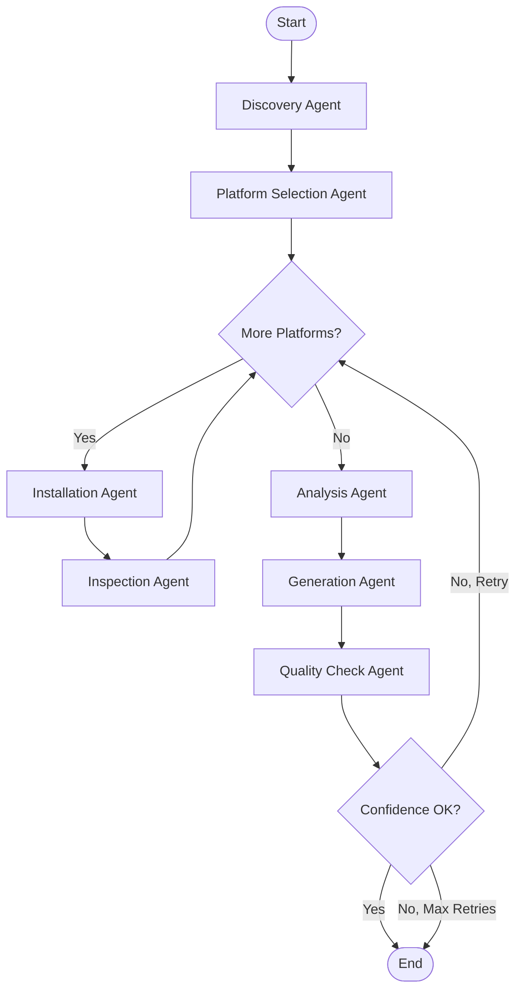

# Saitest Architecture

This document describes the design and architecture of saitest, an agent-based verification tool for generating and validating saidata.

## High-Level Architecture

```
┌─────────────────────────────────────────────────────────────┐
│                     SAITEST CLI                              │
├─────────────────────────────────────────────────────────────┤
│                                                              │
│  ┌──────────────┐      ┌──────────────┐                    │
│  │   Commands   │──────│ Orchestrator │                    │
│  │  verify/test │      │  (LangGraph) │                    │
│  └──────────────┘      └───────┬───────┘                    │
│                                 │                            │
│         ┌───────────────────────┼───────────────────┐       │
│         │                       │                   │       │
│    ┌────▼─────┐         ┌──────▼──────┐     ┌─────▼────┐  │
│    │ Container│         │   Agents    │     │  Tools   │  │
│    │ Manager  │         │  (6 types)  │     │ (System) │  │
│    └────┬─────┘         └──────┬──────┘     └─────┬────┘  │
│         │                      │                   │       │
└─────────┼──────────────────────┼───────────────────┼───────┘
          │                      │                   │
     ┌────▼─────┐         ┌──────▼──────┐     ┌─────▼────┐
     │  Docker  │         │     LLM     │     │ Monitors │
     │ Containers│         │  (GPT-4o)   │     │(FS/Proc) │
     └──────────┘         └─────────────┘     └──────────┘
```

## LangGraph Workflow



## Core Components

### 1. State Management

**VerificationState**
- Central state object passed between all agents
- Tracks workflow progress, observations, and results
- Implemented as TypedDict for type safety

Key fields:
- `software`: Software name to verify
- `selected_platforms`: List of platforms to test
- `current_platform`, `current_provider`: Current test context
- `platform_results`: List of PlatformResult objects
- `generated_saidata`: Final saidata with overrides
- `overall_confidence`: Quality score (0-1)

**Observation**
- Single data point from system monitoring
- Fields: type, platform, provider, timestamp, data, confidence
- Types: file, service, port, command, package

**PlatformResult**
- Results from testing one platform-provider combination
- Fields: platform, provider, success, observations, errors, duration

### 2. Agent Nodes

#### Discovery Agent
- Queries saigen's repository cache for package metadata
- Scans providers/ directory for available providerdata
- Uses LLM to research installation methods if needed
- Outputs: installation_methods, expected_services, expected_files

#### Platform Selection Agent
- Selects 2-4 representative platforms for testing
- Considers different package managers and distributions
- Uses user-specified platforms if provided
- Fallback: ubuntu:22.04, debian:12

#### Installation Agent
- Spawns Docker container for platform
- Executes installation using providerdata commands
- Monitors filesystem changes during installation
- Creates PlatformResult with observations
- Tests each platform-provider combination

#### Analysis Agent
- Aggregates observations across all platforms
- Identifies common patterns (goes in default.yaml)
- Identifies platform-specific variations (goes in overrides)
- Calculates confidence scores

#### Generation Agent
- Generates default.yaml with common configuration
- Generates OS-specific override files for variations
- Follows saidata schema 0.3
- Includes metadata, packages, services, files, commands, ports

#### Quality Check Agent
- Validates generated saidata against schema
- Assesses completeness and accuracy using LLM
- Calculates overall confidence score
- Flags for human review if confidence < 0.7

### 3. Container Management

**ContainerManager**
- Manages Docker container lifecycle
- Maps platforms to Docker images
- Tracks active containers
- Ensures cleanup on exit

**ContainerWrapper**
- Wrapper for container operations
- Methods: exec(), read_file(), list_files()
- Returns structured results with exit codes

### 4. Filesystem Monitoring

**FilesystemMonitor**
- Captures filesystem baseline before installation
- Detects new/modified files after installation
- Finds systemd service files
- Locates installed binaries
- Uses `find` command for efficient scanning

### 5. LangGraph Tools

**install_package**
- Unified tool for installing with any provider
- Loads providerdata for specified provider
- Executes install command from providerdata
- Monitors filesystem changes
- Tests installation using providerdata test command
- Returns observations tagged with provider

**inspect_service**
- Inspects systemd service configuration
- Uses systemctl commands
- Returns service status and configuration

**check_listening_ports**
- Checks which ports are listening
- Uses `ss -tlnp` command
- Returns port, protocol, address

**find_config_files**
- Finds configuration files for software
- Searches common locations (/etc, /usr/local/etc)
- Returns list of config file paths

### 6. Providerdata Integration

**ProviderCommandExecutor**
- Loads providerdata from providers/ directory
- Extracts install/test commands
- Substitutes variables using template engine
- Ensures consistency with sai's behavior

**Provider Extensibility**
- Automatically supports new providers when providerdata added
- No code changes needed for new providers
- Scans providers/ directory at runtime

### 7. Saigen Integration

**Repository Integration**
- Uses saigen's RepositoryDownloader
- Queries repository cache for package metadata
- Extracts versions, dependencies, providers
- Falls back to LLM if repository data unavailable

## Data Flow

1. **Input**: User provides software name and optional platforms
2. **Discovery**: Agent researches installation methods and providers
3. **Platform Selection**: Agent chooses test platforms
4. **Installation Loop**: For each platform-provider combination:
   - Spawn container
   - Capture baseline
   - Execute installation
   - Monitor changes
   - Create observations
5. **Analysis**: Aggregate observations, identify patterns
6. **Generation**: Create default.yaml and OS-specific overrides
7. **Quality Check**: Validate and score results
8. **Output**: Write saidata files to disk

## Multi-Provider Support

Saitest tests all available providers for comprehensive coverage:

### Provider Testing Strategy

1. Discovery Agent identifies available providers
2. Cross-reference with providerdata availability
3. Create platform-provider combinations
4. Test each combination in fresh container
5. Tag observations with provider
6. Generate provider-specific overrides

### Example Workflow

```
nginx on ubuntu:22.04
  → Test with apt (nginx package)
  → Test with snap (nginx snap)
  → Test with source (compile from source)

Result: Saidata with providers.apt, providers.snap, providers.source sections
```

## OS-Specific Overrides

### File Structure

```
output/
└── nginx/
    ├── default.yaml          # Common configuration
    ├── ubuntu/
    │   ├── 22.04.yaml       # Ubuntu 22.04 specific
    │   └── 24.04.yaml       # Ubuntu 24.04 specific
    └── debian/
        └── 12.yaml          # Debian 12 specific
```

### Generation Strategy

1. **Analysis Phase**:
   - Group observations by platform
   - Identify common patterns → default.yaml
   - Identify platform-specific differences → overrides

2. **Generation Phase**:
   - Generate default.yaml with common config
   - For each platform, generate OS-specific override
   - Overrides contain only differences from default

## Error Handling

### Container Errors
- Image not found: Pull image automatically
- Container creation fails: Log error and skip platform
- Command execution fails: Return success=false with error details

### Agent Errors
- LLM returns invalid JSON: Log error, use fallback values
- Tool execution fails: Create failed PlatformResult
- YAML parsing fails: Set generated_saidata=None

### Workflow Errors
- Low confidence: Retry if retry_count < max_retries
- Max retries reached: Complete with current results
- Critical failure: Raise exception with context

## Performance Considerations

### Optimization Strategies
- Cache Docker images locally
- Limit filesystem scanning to relevant paths
- Stream LLM responses for faster feedback
- Parallel platform testing (future enhancement)

### Resource Limits
- Container CPU: 2 cores
- Container memory: 2GB
- Concurrent containers: 4 max (future)
- Timeout per platform: 600 seconds
- Max retries: 2

## Security Considerations

### Container Security
- Use privileged mode only when necessary
- Isolate containers from host network
- Clean up containers after use
- Validate image sources

### LLM Security
- Sanitize user input before sending to LLM
- Validate LLM responses before execution
- Don't execute arbitrary commands from LLM
- Use structured outputs (JSON) when possible

## Design Decisions

### Why LangGraph?
- Built-in state management
- Conditional routing
- Checkpointing for resume
- Tool integration
- Mature ecosystem

### Why Docker?
- Clean, reproducible environments
- Platform diversity support
- Easy cleanup
- Security isolation

### Why Providerdata?
- Single source of truth for provider commands
- Consistency with sai's behavior
- Automatic support for new providers
- Maintainability

### Why OS-Specific Overrides?
- Handles platform differences elegantly
- Follows saigen's established pattern
- Reduces duplication
- Clear separation of concerns

## Future Enhancements

### Phase 2
- Parallel platform testing
- Container image caching
- Incremental verification
- More installation methods (binary, source)

### Phase 3
- Web UI for visualization
- Comparison reports
- Historical tracking
- CI/CD integration
- Custom agent plugins

## Directory Structure

```
saitest/
├── cli/                    # Command-line interface
│   ├── __init__.py
│   └── main.py            # Click commands
├── core/                   # Core orchestration
│   ├── __init__.py
│   ├── orchestrator.py    # LangGraph workflow
│   └── state.py           # State definitions
├── agents/                 # Agent implementations
│   ├── __init__.py
│   ├── discovery.py       # Discovery agent
│   ├── platform.py        # Platform selection
│   ├── installation.py    # Installation agent
│   ├── analysis.py        # Analysis agent
│   ├── generation.py      # Generation agent
│   └── quality.py         # Quality check agent
├── tools/                  # LangGraph tools
│   ├── __init__.py
│   ├── package.py         # install_package tool
│   └── system.py          # System inspection tools
├── models/                 # Data models
│   ├── __init__.py
│   ├── observation.py     # Observation model
│   └── state.py           # State models
├── utils/                  # Utilities
│   ├── __init__.py
│   ├── docker_manager.py  # Container management
│   ├── fs_monitor.py      # Filesystem monitoring
│   ├── provider_executor.py  # Providerdata integration
│   └── repository_integration.py  # Saigen integration
└── docs/                   # Documentation
    ├── README.md
    ├── architecture.md
    ├── cli-reference.md
    └── examples/
```

## Related Documentation

- [CLI Reference](cli-reference.md) - Command documentation
- [Examples](examples/) - Usage examples
- [Main README](README.md) - Overview and quick start
